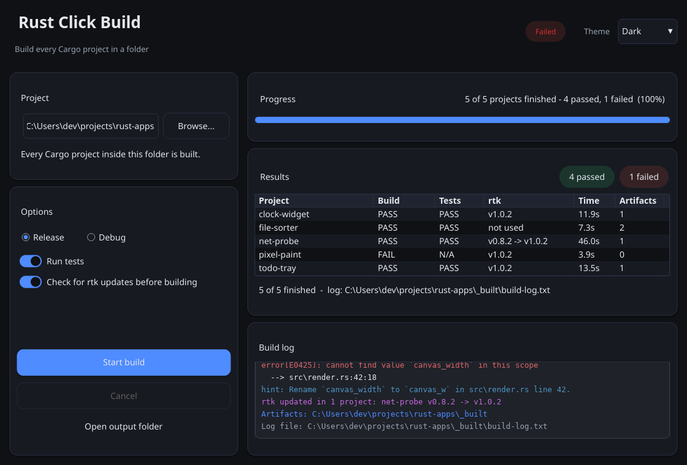

# rust-click-build

Click-and-go Rust builder for Windows. It is **not** a compiler: it finds every Cargo project in a folder and runs `cargo` for you, then collects the `.exe` files.

> **Status: not run on a real Windows machine yet.** PowerShell scripts parse and lint in PowerShell 7. Pester on Linux: **211 passed, 0 failed, 1 skipped** (the skipped case is a real `osslsigncode` sign when that tool is not installed). The native rtk GUI (`gui/`) builds, tests (**44 passed**), and clippy-cleans (`-D warnings`) on Linux, including a real `build.ps1` e2e path and headless theme screenshots in `docs/screenshots/`. Nobody has run `Build.bat`, `BuildGUI.bat`, `signtool.exe`, or `rcb-gui.exe` on Windows yet.

Code checked with: **anthropic/claude-fable-5.2**.

## Use it
1. Download this repo (Code -> Download ZIP) and unzip anywhere.
2. **Double-click `Build.bat`** and pick your project folder, **or drag a folder onto `Build.bat`**.
3. When it finishes, your programs are in `<your folder>\_built\<project>\` and that folder opens automatically. The window waits for Enter before closing.

Prefer a window? Double-click **`BuildGUI.bat`**. That builds and launches the native [rtk](https://github.com/ubcool2ic/rtk) GUI (`gui/`, pinned to tag **v1.2.0**): folder box + Browse, Release/Debug, "Run tests", "Check for rtk updates before building" (on by default), "Sign output" plus cert thumbprint / PFX fields, Start Build, Cancel, a Sign column in the results table, live log, and Light / Dark / High Contrast themes. Use `-ClassicGui` if you want the older WinForms window instead.



*Headless render of `rcb-gui` against rtk v1.2.0 (`docs/screenshots/`). The other eight idle / building / results frames for Light, Dark, and High Contrast are in the same folder.*

## What it does
- Checks for `cargo` (adds `%USERPROFILE%\.cargo\bin` if needed) and the MSVC C++ build tools (via `vswhere`).
- If missing, asks before installing with **winget** (`Rustlang.Rustup`, `Microsoft.VisualStudio.2022.BuildTools` with the VCTools workload). Without winget it downloads `rustup-init.exe` (TLS 1.2, Authenticode check) and opens the Build Tools download page.
- Finds all `Cargo.toml` files with a pruned walk (does not descend into `target\`, `.git`, `node_modules`, or `_built`, follows OneDrive and other directory reparse points / symlinks with loop protection, and only walks a folder named `target` when that folder itself contains `Cargo.toml`). Members inside a `[workspace]` root are skipped (the workspace is built once). Two projects that share a folder name get distinct `_built` subfolders.
- **Forced rtk update check** before every build (see below).
- Runs `cargo build --release` (or debug), optionally `cargo test`, for each project; a failure doesn't stop the rest. You can cancel a run from the GUI.
- Colored progress, first errors per project (`error[E....]` + `file:line`) in red, friendly hints, summary table, log file at `_built\build-<timestamp>.log`.

## rtk update check
Before each project builds, the script looks for [rtk](https://github.com/ubcool2ic/rtk) git dependencies in every `Cargo.toml` of the project (inline `rtk = { git = ... }`, renamed deps with `package = "rtk"`, `[dependencies.rtk]` tables, `target.'cfg(..)'` sections and `[workspace.dependencies]`).

- **Latest release:** `git ls-remote --tags -- <url>` with your own git login (Git Credential Manager), never prompting. If that fails and `GH_TOKEN` is set, it asks the GitHub API instead (paginated). Only stable `vX.Y.Z` tags count.
- **`tag = "..."` older than the latest:** backs up `Cargo.toml` + `Cargo.lock` (workspace-root lock for members) to a unique `_built\rtk-backup-<time>-<project>-<suffix>\`, rewrites the tag, runs `cargo update -p rtk`. The log and summary show `v0.8.2 -> v1.0.1` in colour. If the update itself throws, the backup is restored and the old pin is kept.
- **`branch = "..."` or no pin:** always runs `cargo update -p rtk`.
- **`rev = "..."`:** reported (latest or behind) but **not** rewritten, because a rev pin is a deliberate choice. Change it to a `tag` to get automatic bumps.
- **Build fails after a bump:** restores the backup, rebuilds on the old pin, and only blames rtk when the rebuild on the old pin succeeds. If restore cannot put a file back, the row is marked `ROLLBACK INCOMPLETE`.
- **Offline or no credentials:** prints a loud warning and builds with the pins you already have. A failed lookup is not cached for the rest of the session.
- **Turn it off:** `-NoRtkUpdate`, or untick the checkbox in the GUI.

Only `https://github.com/ubcool2ic/rtk`, `ssh://git@github.com/ubcool2ic/rtk`, and `git@github.com:ubcool2ic/rtk` (optional `.git`) count as rtk URLs.

Cargo is run with `CARGO_NET_GIT_FETCH_WITH_CLI=true` (when git is installed and you haven't set it) so a private rtk repo is fetched with your git login. Child processes have stdin closed, UTF-8 output, `GIT_TERMINAL_PROMPT=0`, and a timeout / cancel path that kills the process tree.

## Look and feel
The default GUI is a native Rust front-end in `gui/`, built against [ubcool2ic/rtk](https://github.com/ubcool2ic/rtk) **v1.2.0** pinned by git tag (`rtk = { git = "...", tag = "v1.2.0" }`) and using only rtk's public API: ModernLight / ModernDark / HighContrast themes, cards, contrast-checked log colours, and an accent **Start Build** button.

The classic WinForms window and the console use the same rtk tokens (copied from rtk `src/style.rs`): Noto Sans 14 px (bundled in `assets/fonts`, SIL OFL), rtk spacing (4/8/12/16/24), cards with 12 px corners and 16 px padding, flat bordered buttons with rtk hover/pressed shades, an accent "Start Build" button, and the ModernDark / ModernLight / high-contrast palettes. The theme follows Windows (light/dark/high contrast) unless you pick one in the Theme box or pass `-Theme Light|Dark|HighContrast`. Console colours use the same palette as 24-bit colour when the console supports it, and the nearest standard colours otherwise (`NO_COLOR` or `RCB_NO_TRUECOLOR=1` turn truecolour off).

`BuildGUI.bat` (or `build.ps1 -Gui`) builds `gui/` with `cargo build --release` when needed and starts `rcb-gui`. The GUI drives `build.ps1 -JsonProgress` as a child process. Pass `-ClassicGui` for the WinForms UI.

## Friendly hints it recognizes
Missing `link.exe` (MSVC), no default toolchain, no internet / crates.io download failures, locked target dir or `.exe` in use, disk full, path too long, no `Cargo.toml` found, invalid folder, winget missing, picker cancelled. It also warns about folder paths with spaces or over 200 characters.


## Signing collected programs
Signing is **off by default**. After a project builds, `build.ps1 -Sign` can Authenticode-sign the `.exe` / `.dll` files copied into `_built`. A signing problem is shown as `SIGN FAILED` on that row, in the GUI results table, and as a `sign` JsonProgress event. If `-Sign` is on and any artifact is marked `SIGN FAILED`, the run fails (exit code 1).

```
powershell -ExecutionPolicy Bypass -File build.ps1 -Path C:\src -Sign -CertThumbprint 001122...AABB
powershell -ExecutionPolicy Bypass -File build.ps1 -Path C:\src -Sign -PfxPath .\dev.pfx
```

- **`-CertThumbprint`**: a 40-character hexadecimal SHA-1 (spaces or colons are allowed) of a code-signing certificate already in the CurrentUser or LocalMachine `My` store (signtool `/sha1`).
- **`-PfxPath`**: a `.pfx` / `.p12` file. The password comes **only** from the environment variable `RCB_SIGN_PFX_PASSWORD`. It is never logged, never placed on a command line, and must not be committed. On Windows the PFX is loaded in-process and the file is signed with `/sha1 <thumbprint>` (a temporary CurrentUser\My import is removed in a `finally` block). For `osslsigncode`, the password is passed with `-readpass` and a `0600` temp file that is wiped and deleted in `finally`. The child process does not inherit `RCB_SIGN_PFX_PASSWORD`.
- Timestamping uses RFC 3161 (`signtool /tr`, `/td SHA256`, `/fd SHA256`). The default URL is `http://timestamp.digicert.com`; override it with `-TimestampUrl`. A non-HTTPS URL is allowed (the token itself is signed) but the run warns once and prefers `https://` when the TSA offers it.
- `signtool.exe` is found on PATH or in the newest `Windows Kits\10\bin\<version>\x64` (or x86 / arm64) folder. After signing, the file is checked with `signtool verify /pa`. If signtool or the certificate is missing, you get a clear error and the artifact is marked `SIGN FAILED`.
- Optional defaults can live in `rcb.sign.json` next to the project folder or the tool (or a path passed as `-SignConfig`). That file is gitignored. It may set `certThumbprint`, `pfxPath`, and `timestampUrl`. A `"sign": true` field does **not** enable signing; only `-Sign` or the GUI **Sign output** toggle does, so a toggle-off always wins. The file must not contain a password.

The rtk GUI has a **Sign output** toggle and thumbprint / PFX fields (public rtk API only). The PFX password is still read from `RCB_SIGN_PFX_PASSWORD`; there is no password box. CLI `--sign`, `--cert-thumbprint`, and `--pfx-path` fill those controls.

### Self-signed certificate for local testing
A self-signed cert is enough to exercise the sign path on your own machine. Windows will still warn on the resulting binary, and SmartScreen will not trust it. Real distribution needs an organization-validated (OV) or extended-validation (EV) code-signing certificate from a public CA.

```
# Windows (as the user who will sign):
$cert = New-SelfSignedCertificate -Type CodeSigningCert -Subject 'CN=Rust Click Build Dev' -CertStoreLocation Cert:\CurrentUser\My
$cert.Thumbprint
# Optional PFX (you will be prompted for a password; then set it in the session only):
Export-PfxCertificate -Cert $cert -FilePath .\dev.pfx -Password (Read-Host -AsSecureString 'PFX password')
$env:RCB_SIGN_PFX_PASSWORD = '...'   # session only; never commit this
```

Do not commit `*.pfx`, `*.p12`, or `rcb.sign.json`.

## Command line
```
Build.bat "C:\src\myproj"                         # release build
powershell -ExecutionPolicy Bypass -File build.ps1 -Path C:\src -BuildProfile debug -Test
BuildGUI.bat                                      # native rtk GUI
powershell -ExecutionPolicy Bypass -File build.ps1 -ClassicGui
```
Switches: `-Path`, `-BuildProfile release|debug`, `-Test`, `-Gui`, `-ClassicGui`, `-JsonProgress`, `-NoPause`, `-NoInstall`, `-NoOpen`, `-NoRtkUpdate`, `-Sign`, `-CertThumbprint`, `-PfxPath`, `-TimestampUrl`, `-SignConfig`, `-Theme System|Light|Dark|HighContrast` (GUI).

Exit codes: `0` all passed, `1` any build/test failed or a requested sign failed, `2` cancelled / invalid folder / nothing to build.

Works with Windows PowerShell 5.1 and PowerShell 7.

## Tests and lint
```
pwsh -c "Invoke-Pester ./tests"                                   # Pester 5+
pwsh -c "Invoke-ScriptAnalyzer -Path . -Recurse -Settings ./PSScriptAnalyzerSettings.psd1"
cd gui && cargo test && cargo clippy --all-targets -- -D warnings
gui/target/release/rcb-gui --screenshot-dir docs/screenshots      # after cargo build --release
```
`tests/RtkUpdate.Tests.ps1` covers tag (old and current), rev (latest and old), branch, unpinned, workspace (members, renamed table form, CRLF) and no-rtk fixtures in `tests/fixtures`, with `git ls-remote`, the GitHub API and `cargo` mocked. `tests/FableFixes.Tests.ps1` covers quoting, hostile rtk URLs, pruned discovery, rollback, and related pipeline cases. `tests/RcbSign.Tests.ps1` covers signing (mocked signtool arguments, missing tool, failure, verify, config, and GUI wiring) and, when `osslsigncode` is installed, a real sign of a throwaway PE with a temp self-signed cert that is deleted afterwards. The pipeline tests use `tests/fixtures/fake-cargo.sh` and are skipped on Windows. `gui/` has unit tests, Unix runner tests, a real `build.ps1` e2e test, and a nine-state screenshot test.
