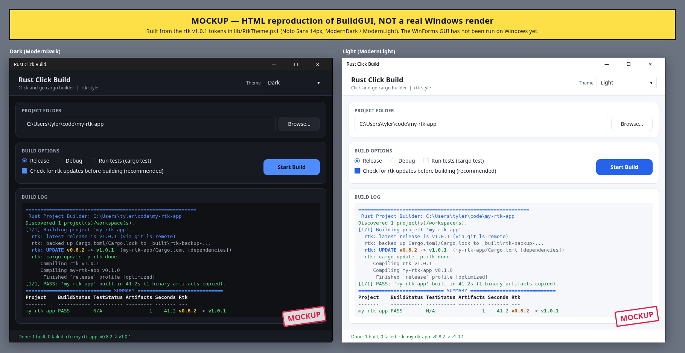

# rust-click-build

Click-and-go Rust builder for Windows. It is **not** a compiler: it finds every Cargo project in a folder and runs `cargo` for you, then collects the `.exe` files.

> **Status: not run on Windows.** The scripts parse and lint clean in PowerShell 7 and the Pester tests pass on Linux with mocked network and a fake `cargo`, but nobody has run `Build.bat` or the WinForms GUI on a real Windows machine yet.

## Use it
1. Download this repo (Code -> Download ZIP) and unzip anywhere.
2. **Double-click `Build.bat`** and pick your project folder, **or drag a folder onto `Build.bat`**.
3. When it finishes, your programs are in `<your folder>\_built\<project>\` and that folder opens automatically. The window waits for Enter before closing.

Prefer a window? Double-click **`BuildGUI.bat`**: folder box + Browse, Release/Debug, "Run tests", "Check for rtk updates before building" (on by default), Build button, live coloured log.



*The image above is an HTML **mockup** of the GUI (`docs/gui-mockup.html`), not a real Windows screenshot.*

## What it does
- Checks for `cargo` (adds `%USERPROFILE%\.cargo\bin` if needed) and the MSVC C++ build tools (via `vswhere`).
- If missing, asks before installing with **winget** (`Rustlang.Rustup`, `Microsoft.VisualStudio.2022.BuildTools` with the VCTools workload). Without winget it downloads `rustup-init.exe` and opens the Build Tools download page.
- Finds all `Cargo.toml` files, skipping `target\`, `.git`, `node_modules`, `_built`, and members inside a `[workspace]` root (the workspace is built once).
- **Forced rtk update check** before every build (see below).
- Runs `cargo build --release` (or debug), optionally `cargo test`, for each project; a failure doesn't stop the rest.
- Colored progress, first errors per project (`error[E....]` + `file:line`) in red, friendly hints, summary table, log file at `_built\build-<timestamp>.log`.

## rtk update check
Before each project builds, the script looks for [rtk](https://github.com/ubcool2ic/rtk) git dependencies in every `Cargo.toml` of the project (inline `rtk = { git = ... }`, renamed deps with `package = "rtk"`, `[dependencies.rtk]` tables, `target.'cfg(..)'` sections and `[workspace.dependencies]`).

- **Latest release:** `git ls-remote --tags` with your own git login (Git Credential Manager), never prompting. If that fails and `GH_TOKEN` is set, it asks the GitHub API instead. Only stable `vX.Y.Z` tags count.
- **`tag = "..."` older than the latest:** backs up `Cargo.toml` + `Cargo.lock` to `_built\rtk-backup-<time>-<project>\`, rewrites the tag, runs `cargo update -p rtk`. The log and summary show `v0.8.2 -> v1.0.1` in colour.
- **`branch = "..."` or no pin:** always runs `cargo update -p rtk`.
- **`rev = "..."`:** reported (latest or behind) but **not** rewritten, because a rev pin is a deliberate choice. Change it to a `tag` to get automatic bumps.
- **Build fails after a bump:** restores the backup, rebuilds on the old pin, and marks the project `rtk update broke the build, kept vX` with the first compiler errors from the new rtk.
- **Offline or no credentials:** prints a loud warning and builds with the pins you already have.
- **Turn it off:** `-NoRtkUpdate`, or untick the checkbox in the GUI.

Cargo is run with `CARGO_NET_GIT_FETCH_WITH_CLI=true` (when git is installed and you haven't set it) so the private rtk repo is fetched with your git login.

## Look and feel
The GUI and console use rtk's own theme (tokens copied from rtk v1.0.1 `src/style.rs`): Noto Sans 14 px (bundled in `assets/fonts`, SIL OFL), rtk spacing (4/8/12/16/24), cards with 12 px corners and 16 px padding, flat bordered buttons with rtk hover/pressed shades, an accent "Start Build" button, and the ModernDark / ModernLight / high-contrast palettes. The theme follows Windows (light/dark/high contrast) unless you pick one in the Theme box or pass `-Theme Light|Dark|HighContrast`. Console colours use the same palette as 24-bit colour when the console supports it, and the nearest standard colours otherwise (`NO_COLOR` or `RCB_NO_TRUECOLOR=1` turn truecolour off).

## Friendly hints it recognizes
Missing `link.exe` (MSVC), no default toolchain, no internet / crates.io download failures, locked target dir or `.exe` in use, disk full, path too long, no `Cargo.toml` found, invalid folder, winget missing, picker cancelled. It also warns about folder paths with spaces or over 200 characters.

## Command line
```
Build.bat "C:\src\myproj"                         # release build
powershell -ExecutionPolicy Bypass -File build.ps1 -Path C:\src -BuildProfile debug -Test
```
Switches: `-Path`, `-BuildProfile release|debug`, `-Test`, `-Gui`, `-NoPause`, `-NoInstall`, `-NoOpen`, `-NoRtkUpdate`, `-Theme System|Light|Dark|HighContrast` (GUI).

Exit codes: `0` all passed, `1` any build/test failed, `2` cancelled / invalid folder / nothing to build.

Works with Windows PowerShell 5.1 and PowerShell 7.

## Tests and lint
```
pwsh -c "Invoke-Pester ./tests"                                   # Pester 5+
pwsh -c "Invoke-ScriptAnalyzer -Path . -Recurse -Settings ./PSScriptAnalyzerSettings.psd1"
```
`tests/RtkUpdate.Tests.ps1` covers tag (old and current), rev (latest and old), branch, unpinned, workspace (members, renamed table form, CRLF) and no-rtk fixtures in `tests/fixtures`, with `git ls-remote`, the GitHub API and `cargo` mocked. The pipeline tests use `tests/fixtures/fake-cargo.sh` and are skipped on Windows.

